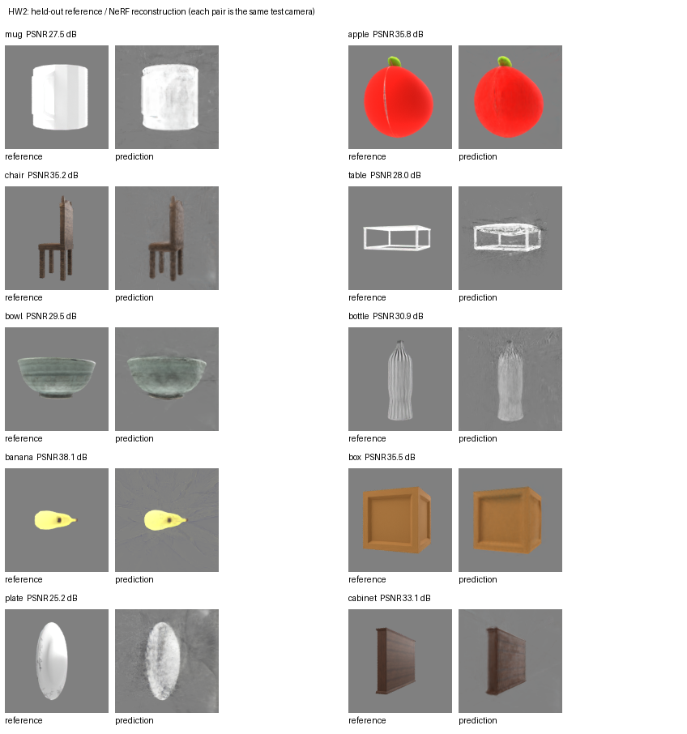
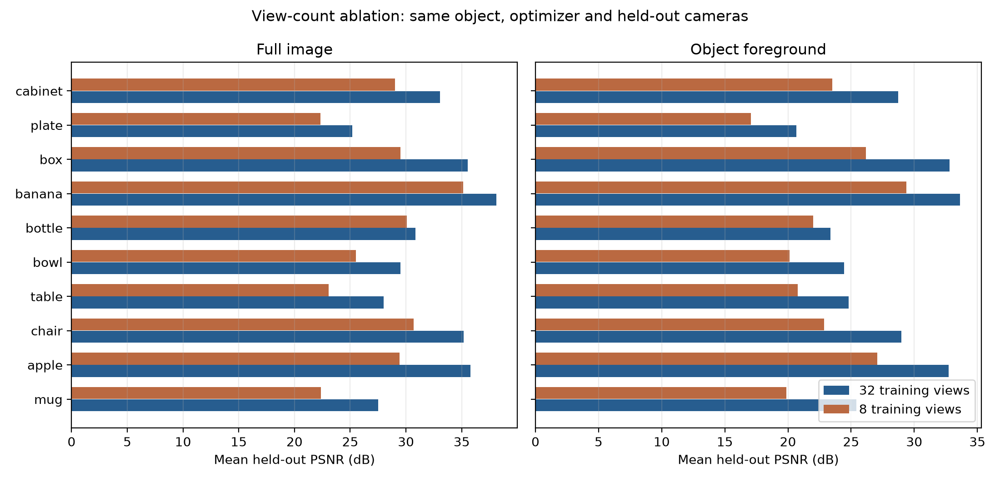

# HW2 Pipeline Report: 3D Reconstruction and Rendering

## Team and repository

- **Group:** TODO — enter group number.
- **Members and contributions:** TODO — enter each member’s name and contribution.
- **GitHub repository:** TODO — add the public or course-accessible repository URL.

This report records the completed local pipeline and results. All ten objects have verified image datasets, selected point-matching results, NeRF checkpoints, held-out evaluations, and orbit GIFs. Group details and the future GitHub URL remain TODO fields for the team to fill in.

## 1. Pipeline overview

The pipeline has four stages: (1) select and reproduce ten HW1-normalized assets; (2) render calibrated synthetic views; (3) diagnose image correspondences using SIFT and two-view geometry; and (4) train a compact feature-grid NeRF from RGB images and known cameras, evaluate on held-out views, and render an orbit GIF. Source geometry is used to create supervision images only. NeRF receives the RGB images, calibrated poses, and alpha masks; it does not load mesh geometry, depth, or normals.

### Data and camera setup

The selected HW1 core-tier objects are mug, apple, chair, table, bowl, bottle, banana, box, plate, and cabinet. The cupboard was excluded as similar to cabinet. Preparation preserves source hashes, applies the same HW1 GLB normalization and checks its saved transform/hash. The verified dataset contains 36 views per object (32 train, four test), 360 images total, with distinct train/test poses. Views sample eight azimuths at elevations −20°, 10°, 35°, and 60°; test views use intermediate azimuths and different elevations. Images are 128×128 perspective renders with fixed shared illumination, composited over neutral gray RGB(128,128,128), and accompanied by separate alpha masks. The camera radius is 1.9 for eight objects and 2.8 for box and table; the latter were rerendered farther away after 1.9 clipped their silhouettes. Verification reports zero foreground pixels on image borders for every view. Camera intrinsics and Blender/OpenGL camera-to-world transforms are saved in each `transforms.json`. `data/verification.json` reports status `passed`.

### Feature matching and pose diagnostics

`match_features.py` extracts up to 4,000 OpenCV SIFT features from training images, excluding masked background pixels. Candidate pairs are chosen deterministically from nearby views. Descriptor matches use a bidirectional mutual Lowe ratio test (0.8); a 1.5-pixel RANSAC threshold is used for fundamental/essential geometry. The best pair is selected by inlier count, then mutual-match count. This is a pairwise diagnostic, not a multi-view SfM reconstruction. Known camera poses are used for a separate post-hoc epipolar quality diagnostic only; pose inputs to NeRF are the calibrated synthetic poses.

| Object | Successful / tested pairs | Best pair | Best inliers / matches | Outcome |
|---|---:|---|---:|---|
| Apple | 0 / 24 | 012–020 | 0 / 5 | no successful geometry |
| Banana | 0 / 24 | 002–010 | 0 / 7 | no successful geometry |
| Bottle | 0 / 24 | 004–012 | 0 / 7 | no successful geometry |
| Bowl | 11 / 24 | 028–029 | 26 / 26 | estimated |
| Box | 0 / 24 | 002–010 | 7 / 9 | no successful geometry |
| Cabinet | 3 / 24 | 014–022 | 15 / 15 | estimated |
| Chair | 5 / 24 | 014–022 | 16 / 18 | estimated |
| Mug | 0 / 24 | 024–031 | 0 / 6 | no successful geometry |
| Plate | 3 / 24 | 006–014 | 68 / 73 | estimated |
| Table | 0 / 24 | 025–026 | 0 / 3 | no successful geometry |

The original SIFT 0.8 baseline accepted at least one pair for four of ten objects (bowl, cabinet, chair, plate). At ratio 0.9, SIFT and ORB each estimated seven objects; AKAZE estimated one (plate). A later exploratory index compared detector/ratio variants using 24 candidate pairs per trial and extended retries to 37 pairs for mug, banana, and table. It selected the best pair post hoc with known-pose epipolar QC, so the 8/10 result is descriptive, not a fixed-method test on held-out objects. The banana pair is borderline because it has only 9 F-inliers, just one above the 8-inlier minimum; 8 of those 9 (88.9%) agree with known-pose geometry. The selected-pair index reports:

| Object | Selected pair | Detector | Mutual matches | F-RANSAC inliers | Inliers consistent with known-pose geometry | Median calibrated error (px) | QC |
|---|---|---|---:|---:|---:|---:|---|
| Apple | 030–031 | ORB | 28 | 23 | 23 | 0.45 | pass |
| Banana | 010–018 | SIFT | 9 | 9 | 8 | 0.30 | pass |
| Bottle | 020–028 | ORB | 25 | 21 | 21 | 0.10 | pass |
| Bowl | 027–028 | SIFT | 41 | 36 | 35 | 0.16 | pass |
| Box | 004–012 | SIFT | 14 | 10 | 8 | 0.24 | pass |
| Cabinet | 014–022 | SIFT | 20 | 16 | 12 | 0.32 | pass |
| Chair | 002–010 | ORB | 55 | 48 | 48 | 0.22 | pass |
| Mug | 028–029 | ORB | 23 | 18 | 1 | 14.30 | fail |
| Plate | 006–014 | ORB | 325 | 228 | 222 | 0.21 | pass |
| Table | 026–027 | SIFT | 5 | 0 | 0 | — | fail |

The selected index accepted eight of ten objects (apple, banana, bottle, bowl, box, cabinet, chair, plate) using a minimum of eight F-RANSAC inliers, with at least 75% of those inliers within 1.5 px of calibrated epipolar geometry and median error no greater than 1.5 px. This uses exact synthetic poses after matching to reject geometrically inconsistent pairs; it is not image-only pose recovery. Sparse or absent texture, repetitive patterns, low mutual match counts, and changing visibility plausibly limit matching.

### NeRF method

`nerf.py` implements a compact radiance field with a learned 64³ density grid, an eight-channel feature grid, and a small directional RGB MLP. Trilinear grid sampling provides point features and softplus density; the MLP predicts color from features and ray direction. Stratified ray samples between near/far bounds are integrated with emission-absorption volume compositing. Training samples foreground and background rays in equal proportions, minimizes RGB MSE plus `0.02 × opacity-mask MSE`, and applies a smooth learning-rate decay. The fixed seed is 2503. All ten production runs used 10,000 steps, 2,048 rays per step, 64 samples per ray, a 64³ grid, and eight feature channels. Four held-out images are rendered and scored per object; each fitted field produces a 48-frame, 20° elevation orbit GIF.

## 2. Results and analysis

### Current held-out evaluation

All ten objects have a completed held-out evaluation and GIF. The mean of the ten per-object test-view means is **31.87 dB PSNR** and **27.56 dB foreground PSNR**. Across objects, mean PSNR ranges from 25.20 dB (plate) to 38.09 dB (banana); mean foreground PSNR ranges from 20.66 dB (plate) to 33.63 dB (banana). Runs averaged 46.5 seconds on an NVIDIA GeForce RTX 5070 Ti (PyTorch 2.9.0+cu128; CUDA 12.8); individual run time is recorded in each metrics file. Image-wide PSNR includes background pixels, so foreground PSNR better isolates object appearance. These are synthetic held-out views from the same renderer and lighting setup, not real photographs or an independently reconstructed camera trajectory.

| Object | Train views | Held-out views | Mean PSNR | Mean foreground PSNR | Orbit GIF |
|---|---:|---:|---:|---:|---|
| Apple | 32 | 4 | 35.78 dB | 32.73 dB | `results/apple/orbit.gif` |
| Banana | 32 | 4 | 38.09 dB | 33.63 dB | `results/banana/orbit.gif` |
| Bottle | 32 | 4 | 30.86 dB | 23.37 dB | `results/bottle/orbit.gif` |
| Bowl | 32 | 4 | 29.50 dB | 24.45 dB | `results/bowl/orbit.gif` |
| Box | 32 | 4 | 35.53 dB | 32.80 dB | `results/box/orbit.gif` |
| Cabinet | 32 | 4 | 33.07 dB | 28.72 dB | `results/cabinet/orbit.gif` |
| Chair | 32 | 4 | 35.18 dB | 28.98 dB | `results/chair/orbit.gif` |
| Mug | 32 | 4 | 27.51 dB | 25.43 dB | `results/mug/orbit.gif` |
| Plate | 32 | 4 | 25.20 dB | 20.66 dB | `results/plate/orbit.gif` |
| Table | 32 | 4 | 28.00 dB | 24.80 dB | `results/table/orbit.gif` |
| **Mean across objects** | **32** | **4** | **31.87 dB** | **27.56 dB** | — |



### Factors affecting reconstruction

The pipeline exposes several influential factors. Camera calibration determines ray directions and scene scale; here it is provided exactly, making the radiance-field experiment easier than real capture but bypassing SfM error propagation. View coverage (azimuth/elevation and held-out novelty) controls visibility of backsides, tops, and thin structures. Surface texture affects feature matching strongly: the SIFT 0.8 baseline accepted at least one pair on four objects, while post-hoc multi-variant QC selected eight. Detector choice also changes the pairwise geometry rate (SIFT/ORB 0.9: 7/10 each; AKAZE 0.9: 1/10). These are matching outcomes only; known poses still provide NeRF supervision when image matching fails. Foreground masks make ray sampling and silhouette supervision possible; incorrect masks or background compositing would bias both color and opacity. Grid resolution, feature channels, ray/sample counts, ray bounds, optimizer rates, and training iterations trade detail, speed, and stability. Fixed illumination and a shared gray background reduce nuisance variation but restrict generalization to other lighting and backgrounds. Apart from the view-count ablation below, this controlled synthetic setup does not isolate each factor experimentally; the other points are pipeline dependencies and evidence-based interpretations, not measured causal effects.

### Limitations

All ten runs, checkpoints, metrics, held-out renders, and GIFs are present. SIFT pair counts measure local two-view matches rather than complete reconstruction quality. The feature-grid field is a compact coursework implementation; limited resolution and view count can blur fine geometry or appearance. Synthetic images, exact poses, fixed lighting, and source-mesh-derived masks give unusually favorable supervision compared with real capture. The held-out views share the same renderer and scene parameters, and no real-image evaluation is included. Asset licenses differ; the table is CC BY-NC 4.0, so its images must not be reused commercially. Follow `data/ATTRIBUTION.md` and preserve original source credit.

### View-count ablation

A controlled ablation used 8 versus 32 training views per object with the same seed, model, and 10,000 optimization steps. The eight training views were selected by greedy farthest camera direction; all four held-out views were unchanged. Averaged across the ten objects, 8-view PSNR was 27.71 dB (foreground 22.88 dB), versus 31.87 dB (foreground 27.56 dB) with 32 views: a mean full-minus-sparse gap of 4.16 dB and 4.68 dB foreground PSNR. All ten objects scored lower with eight views; the smallest PSNR gap was 0.76 dB for bottle. This supports a view-coverage effect under this fixed setup, but is one seeded run per object and does not isolate every other factor.

| Object | 8-view PSNR | 32-view PSNR | Gap | 8-view foreground PSNR | 32-view foreground PSNR |
|---|---:|---:|---:|---:|---:|
| Mug | 22.37 | 27.51 | 5.14 | 19.87 | 25.43 |
| Apple | 29.42 | 35.78 | 6.37 | 27.09 | 32.73 |
| Chair | 30.70 | 35.18 | 4.48 | 22.84 | 28.98 |
| Table | 23.05 | 28.00 | 4.95 | 20.76 | 24.80 |
| Bowl | 25.52 | 29.50 | 3.99 | 20.12 | 24.45 |
| Bottle | 30.10 | 30.86 | 0.76 | 22.00 | 23.37 |
| Banana | 35.15 | 38.09 | 2.94 | 29.38 | 33.63 |
| Box | 29.50 | 35.53 | 6.04 | 26.18 | 32.80 |
| Plate | 22.34 | 25.20 | 2.87 | 17.08 | 20.66 |
| Cabinet | 29.01 | 33.07 | 4.06 | 23.50 | 28.72 |



## 3. Reproducibility and artifacts

Run data preparation from the project root using the HW1 environment described in `DATA_PREPARATION.md`; use the bundled Python 3.13 interpreter for feature matching and NeRF:

```powershell
& 'F:/dataset/ME2503/hw1_work/env/Scripts/python.exe' -B hw2/prepare_data.py
& 'E:/ComfyUI_windows_portable/python_embeded/python.exe' -B hw2/match_features.py
& 'E:/ComfyUI_windows_portable/python_embeded/python.exe' -B hw2/nerf.py --input hw2/data/mug --output hw2/results/mug --steps 10000 --rays 2048 --grid 64 --channels 8 --samples 64 --seed 2503
```

Use the corresponding `--input hw2/data/<object>` and `--output hw2/results/<object>` for every category. The source GLBs must be available locally as described in `DATA_PREPARATION.md`; they are not included. The preparation script supports `--prepare-only`, `--render-only`, `--verify-only`, and `--force-render`. `data/manifest.json`, `data/verification.json`, `matches/summary.csv`, per-object match JSON/overlays, `results/<object>/metrics.json`, held-out prediction/reference images, checkpoints, and orbit GIFs are the reproducibility record. `.local_assets` is temporary and must be excluded from the submitted repository. Retain image attribution in `data/ATTRIBUTION.md`.

## References and attribution

The data lineage and asset licenses are recorded in `data/manifest.json` and `data/ATTRIBUTION.md`; the object names, creators, license links, and original Sketchfab pages are listed there. HW1 normalization implementation provenance and hashes are documented under `vendor/hw1_normalization/PROVENANCE.json`. The field is a DVGO-inspired compact feature-grid NeRF, not a reproduction of DVGO; see [NeRF](https://www.matthewtancik.com/nerf) and [Direct Voxel Grid Optimization](https://sunset1995.github.io/dvgo/). Feature extraction and robust estimation use OpenCV 4.12.0 ([SIFT](https://docs.opencv.org/4.x/da/df5/tutorial_py_sift_intro.html), [findFundamentalMat](https://docs.opencv.org/4.x/d9/d0c/group__calib3d.html)).
